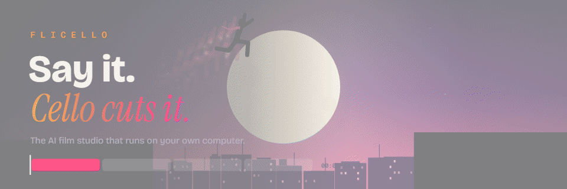
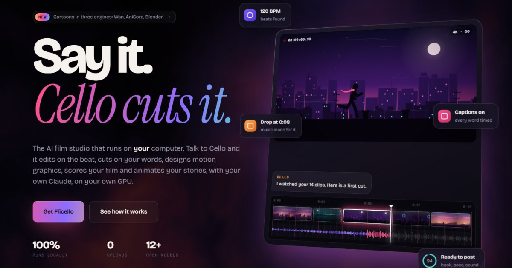
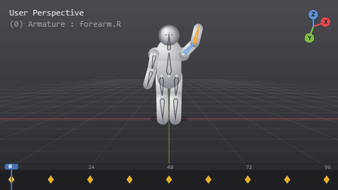

<p align="center">
  <a href="https://flicello.com"></a>
</p>

<h1 align="center">Flicello</h1>

<p align="center">
  <b>An AI film studio that runs on your own computer.</b><br>
  Talk to Cello: it edits your clips on the beat, cuts talking videos on your words, designs motion graphics,
  writes your music and animates cartoons, with your own Claude, on your own GPU.
</p>

<p align="center">
  <a href="https://flicello.com">flicello.com</a> ·
  <a href="#quick-start">Quick start</a> ·
  <a href="#what-it-does">What it does</a> ·
  <a href="#cartoons-four-ways">Cartoons</a> ·
  <a href="#acknowledgements">Acknowledgements</a>
</p>

<p align="center">
  
  
  
</p>

---

Flicello is free and open source. There are no accounts, no credits and no cloud: it runs on your machine, uses
your Claude Code plan as its brain, and runs its image, music, sound, voice and video models on your own GPU.
Your footage never leaves your computer except as the parts a step sends to a service you connect yourself.

> **Status:** early and moving fast. Some parts are solid, some are experimental; each is marked below.

<p align="center">
  
</p>

## What it does

| | |
|---|---|
| 🎬 **Edits from your clips** | Cello watches your footage with its sound, finds the moments, pitches a story and cuts it on the music's beats and hits, in any style (cinematic, hype, travel, documentary) and shape (9:16, 16:9, 4:5, square). |
| 🗣️ **Talking videos, cut on your words** | Every word timed by Whisper. Pauses and "um"s go, cuts never land mid-word, captions land on the syllable. |
| ✨ **Motion graphics, designed for the moment** *(experimental)* | No templates: Claude designs each scene as code (HyperFrames + GSAP) for what you're saying, paints real assets on your GPU, cuts you out cleanly so things can go behind you, checks its own frames and passes a strict review. |
| 🎵 **Music made for your cut** | An original track at your film's length and tempo, made on your GPU (ACE-Step 1.5). The drop lands on your best shot; a stretch can be remade in place. |
| 💥 **A sound on every hit** | Each sound effect generated from its description (Stable Audio 3) and placed on its frame. |
| 🐾 **Cartoons** *(experimental)* | Tell it a story and get an animated film: Claude directs, a real animation engine makes the motion. [Four ways](#cartoons-four-ways). |
| ✂️ **A real editor** | A timeline with trim, split, ripple, keyframes, speed, levels, ducking and undo. Cello and you work on the same timeline. |
| 💬 **Cello, out loud** | Point at the screen and say what you want. Cello sees what you see, does it, and tells you what changed. Whisper hears you, Claude thinks with Cello's tools, Kokoro speaks; talk over it and it stops. |
| 📦 **Exports** | MP4 in every shape, captions (SRT), ProRes, GIF, a thumbnail, MP3, and project files for Final Cut (FCPXML), Premiere and Resolve (EDL). |
| ✅ **Checks** | A ready-to-post score and an honest AI viewer's review before you publish. |

Everything is asked for in plain words ("shot 3 out", "make the ending calmer", "captions in karaoke style") and
shown as an instant draft before anything is rendered. Every version is kept.

<p align="center">
  
</p>

## Cartoons, four ways

Claude writes the board (the story, the look, the cast, every shot's size, angle and action) and directs each shot.
The motion comes from a real animation engine, chosen per film:

<table>
  <tr>
    <td width="33%"></td>
    <td width="33%"></td>
    <td width="33%"></td>
  </tr>
  <tr>
    <td align="center"><b><code>cartoon</code></b><br><sub>painted, then alive</sub></td>
    <td align="center"><b><code>anime</code></b><br><sub>on twos, with impact frames</sub></td>
    <td align="center"><b><code>rig</code></b><br><sub>real bones, no AI video</sub></td>
  </tr>
</table>

The fourth engine, **`drawn`**, makes films like the ones on these pages: the loops above and the film on
[flicello.com](https://flicello.com) are drawn in code with its kit.

<sub>These loops are drawn in code to show each engine's character (they are the same scenes as on
<a href="https://flicello.com">flicello.com</a>), not output from the engines.</sub>

| Engine | How it moves | Best for |
|---|---|---|
| **`cartoon`** · [Wan 2.2](https://github.com/Wan-Video/Wan2.2) | Each shot's full frame is painted on model, then a video model brings the whole frame to life: bodies, fur, cloth, light and camera. | Painted, cinematic cartoons |
| **`anime`** · [AniSora](https://github.com/bilibili/index-anisora) | The same, with Bilibili's open anime model: held poses, snappy action, anime camera moves, start and end frames you set. | Anime |
| **`rig`** · [Blender](https://www.blender.org) | Every character built as a real rig (bones, a bending mesh, face controls) by Claude's scripts; every shot a set with the cast posed, keyed, lit and filmed in Blender. No AI video. | Toon or stylised 3D with exact control |
| **`drawn`** · code | Every character drawn in code with its own rig and faces (checked on a model sheet), every shot the whole frame drawn as a function of time: layered depth, light, wind, particles, a camera, motion blur. Rendered frame by frame by HyperFrames. No AI video, no 3D, no GPU. | Illustrated looks: silhouettes, cel shading, flat colour, paper; any machine |

Every clip is checked by an animation director against the model sheets (same character, the right action, no
morphing or looping) and made again when it drifts. A run picks up where it stopped: if your Claude plan hits its
limit, everything finished is kept.

## What runs where

| Part | Runs on | Model |
|---|---|---|
| The brain | your Claude Code plan (or the Anthropic API) | Claude |
| Painting | your GPU | [Qwen-Image-Edit-2509](https://huggingface.co/Qwen/Qwen-Image-Edit-2509) (optional fast mode: Lightning LoRA) |
| Music | your GPU | [ACE-Step 1.5 XL](https://github.com/ace-step/ACE-Step-1.5) |
| Sound effects | your GPU (or CPU) | [Stable Audio 3 Small-SFX](https://huggingface.co/stabilityai/stable-audio-3-small-sfx) |
| Cartoon motion | your GPU, or any machine | [Wan 2.2 I2V](https://github.com/Wan-Video/Wan2.2), [AniSora V3.2](https://github.com/bilibili/index-anisora), [Blender](https://www.blender.org), or drawn in code |
| Cut-outs, depth, object removal, upscaling | your GPU or CPU | BiRefNet, MODNet, Depth Anything V2, LaMa, Real-ESRGAN (ONNX) |
| Speech | your machine | [faster-whisper](https://github.com/SYSTRAN/faster-whisper) |
| Cello's voice | your machine | Whisper + Claude + [Kokoro-82M](https://huggingface.co/hexgrad/Kokoro-82M) |

Optional services, if you'd rather: **Gemini** (watches footage with sound; Cello's live voice), **ElevenLabs**
(music and sound effects), **Higgsfield** (AI-generated shots), the **Anthropic API** instead of your plan. Keys stay
in your computer's keychain and are never sent anywhere but their own service.

## Built for powerful machines

Flicello is made for the best result, not for every computer. It never quietly lowers its quality to fit a smaller
machine; the Connect page tells you what yours has.

| | Recommended | For every model at once |
|---|---|---|
| GPU | NVIDIA with 24 GB+, or Apple Silicon M2 Pro+ | NVIDIA with 80 GB (A100 / H100 class) |
| Memory | 32 GB | 64 GB+ |
| Disk | 100 GB free | 250 GB free |
| Claude | Claude Code, logged in (Max recommended for cartoons and designed scenes) | |

No GPU of your own? Rent one by the hour (RunPod, Vast.ai and the like) and run Flicello there.

## Quick start

You need [Python 3.11+](https://www.python.org/downloads/), [Node.js 22+](https://nodejs.org),
[FFmpeg 7+](https://ffmpeg.org/download.html) and [Claude Code](https://docs.anthropic.com/claude-code), logged in.

```bash
git clone https://github.com/SIDDHANTH-THAKURI/Flicello
cd Flicello
./flicello          # macOS / Linux / Git Bash
flicello.cmd        # Windows
```

The first run sets up its Python environment, builds the app and the motion engine, and opens
**http://127.0.0.1:8765/connect**. There:

1. **Copy the setup prompt into Claude Code.** It checks your machine and installs whatever is missing (tools,
   models, the GPU extras below), explaining each step. It never touches your keys.
2. **Add any keys you want** (all optional). Everything shows green or red, live; if a service runs out of credit
   while you work, Connect and Cello tell you plainly.

GPU extras, installed by the setup prompt or by hand (with the PyTorch build for your GPU):

```bash
pip install -e ".[paint]"    # the painter
pip install -e ".[sound]"    # music and sound effects (+ stable-audio-3, see the Connect page)
pip install -e ".[video]"    # cartoon and anime motion
python -m vidosuper.motion.videogen prepare cartoon   # Wan 2.2, about 70 GB
python -m vidosuper.motion.videogen prepare anime     # AniSora V3.2, about 70 GB
```

## Who pays for what

You do, directly, and only for what you use: your Claude plan (or the Anthropic API), and any service you choose to
connect. The models on your GPU cost nothing per use. Flicello itself is free.

## Under the hood

Python (FastAPI) and a Vite front end; FFmpeg for video; HyperFrames + GSAP for designed scenes; diffusers for the
painter and the video models; ONNX Runtime for cut-outs, depth, object removal and upscaling; Blender for rigs; Claude
Code agent sessions ("desks") for creative work, each with its own small set of commands. The command line and the
older tools: [docs/vidosuper-cli.md](docs/vidosuper-cli.md).

```bash
pip install -e ".[ai,studio,dev]"
pytest
```

## Acknowledgements

Flicello stands on the work of many open projects. Thank you to everyone who built and shared them.

**Models**
- [Wan 2.2](https://github.com/Wan-Video/Wan2.2) by Alibaba's Wan team (Apache-2.0): image-to-video for cartoons.
- [Index-AniSora](https://github.com/bilibili/index-anisora) by Bilibili (Apache-2.0): anime video.
- [Qwen-Image-Edit-2509](https://huggingface.co/Qwen/Qwen-Image-Edit-2509) by the Qwen team (Apache-2.0) and
  [Qwen-Image-Lightning](https://huggingface.co/lightx2v/Qwen-Image-Lightning) by LightX2V (Apache-2.0): painting.
- [ACE-Step 1.5](https://github.com/ace-step/ACE-Step-1.5) (MIT): music.
- [Stable Audio 3](https://github.com/Stability-AI/stable-audio-3) by Stability AI (code MIT; weights under the
  Stability AI Community License): sound effects. Powered by Stability AI.
- [Whisper](https://github.com/openai/whisper) by OpenAI (MIT) via
  [faster-whisper](https://github.com/SYSTRAN/faster-whisper) (MIT): speech.
- [Kokoro-82M](https://huggingface.co/hexgrad/Kokoro-82M) (Apache-2.0) via
  [kokoro-onnx](https://github.com/thewh1teagle/kokoro-onnx) (MIT): Cello's voice.
- [BiRefNet](https://github.com/ZhengPeng7/BiRefNet) (MIT), [MODNet](https://github.com/ZHKKKe/MODNet) (Apache-2.0),
  [U²-Net](https://github.com/xuebinqin/U-2-Net) (Apache-2.0),
  [Depth Anything V2 Small](https://huggingface.co/depth-anything/Depth-Anything-V2-Small) (Apache-2.0),
  [LaMa](https://github.com/advimman/lama) (Apache-2.0), [Real-ESRGAN](https://github.com/xinntao/Real-ESRGAN)
  (BSD-3-Clause): cut-outs, depth, object removal and upscaling.

**Engines and libraries**
- [Claude Code](https://docs.anthropic.com/claude-code) by Anthropic: the brain and the desks.
- [HyperFrames](https://github.com/heygen-com/hyperframes) by HeyGen (Apache-2.0) and [GSAP](https://gsap.com):
  designed scenes rendered frame by frame.
- [Blender](https://www.blender.org) (GPL): rigs and 3D.
- [Diffusers](https://github.com/huggingface/diffusers), [Transformers](https://github.com/huggingface/transformers)
  and the [Hugging Face Hub](https://huggingface.co) (Apache-2.0); [PyTorch](https://pytorch.org) (BSD-3-Clause);
  [ONNX Runtime](https://onnxruntime.ai) (MIT).
- [FFmpeg](https://ffmpeg.org) (LGPL/GPL), [FastAPI](https://fastapi.tiangolo.com) (MIT),
  [Vite](https://vitejs.dev) (MIT), [mediabunny](https://github.com/Vanilagy/mediabunny) (MPL-2.0).

The full list with every licence and its terms (including GSAP's licence and the model licences) is in
[THIRD_PARTY.md](THIRD_PARTY.md).

## Licence

[MIT](LICENSE). Third-party parts keep their own licences: see [THIRD_PARTY.md](THIRD_PARTY.md).
